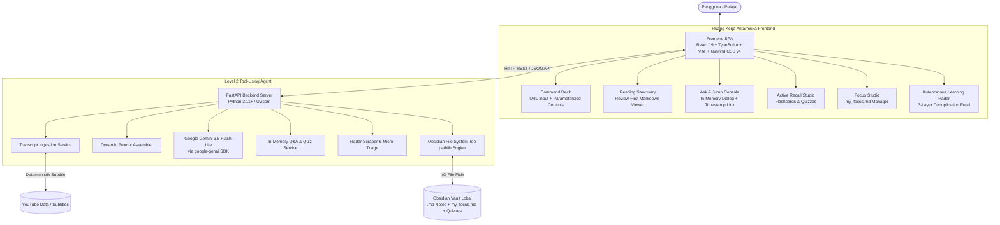

# Agentic Knowledge Curator (Second Brain Learning Companion)

[](https://www.python.org/)
[](https://fastapi.tiangolo.com/)
[](https://react.dev/)
[](https://www.typescriptlang.org/)
[](https://vitejs.dev/)
[](https://tailwindcss.com/)
[](https://ai.google.dev/)
[](https://obsidian.md/)
[](https://pytest.org/)

> **Prototipe Tugas PKI (Perancangan Komputasi Interaktif / HCI)**  
> **Status:** MVP Phase 1 — *Agentic Level 2 Tool-Using Agent*  
> **Arsitektur:** *Local-First Interactive Second Brain Companion*

---

## 📖 Ringkasan Proyek

**Agentic Knowledge Curator** adalah asisten kurasi materi cerdas tingkat 2 (*Tool-Using Agent*) berbasis desktop lokal yang dirancang untuk mempercepat proses belajar mandiri dari video pembelajaran YouTube. 

Alih-alih menghabiskan waktu menonton video panjang berulang kali, agen ini:
1. **Mengekstrak materi transkrip** secara deterministik via `youtube-transcript-api`.
2. **Merakit instruksi dinamis (*Parameterized Prompting*)** sesuai preferensi kedalaman belajar pengguna (*Cheat-Sheet*, *Deep Dive*, *Code & Action*) beserta kotak centang modular (Timestamp, Pitfalls, Code Snippets).
3. **Menganalisis dan mengklasifikasikan materi** ke dalam domain pengetahuan otomatis (*Auto-Categorization*) menggunakan model **Google Gemini 3.5 Flash Lite**.
4. **Mempersistensikan catatan Markdown (`.md`)** ke dalam subfolder kategori di **Obsidian Vault** lokal pengguna (*mutasi lingkungan fisik*).
5. **Menyediakan sesi tanya-jawab interaktif (*Ask & Jump Q&A*)** dengan penanda waktu (*timestamp jump*) tanpa menonton ulang video.
6. **Menyediakan studio *Active Recall* (Flashcards & Quizzes)** untuk menguji retensi konsep secara instan dan mengarsipkannya ke dalam vault.
7. **Menyediakan *Autonomous Learning Radar*** untuk penemuan video kurasi otomatis berdasarkan pilar topik belajar pengguna (`my_focus.md`).

---

## 📐 Arsitektur Sistem



---

## ✨ Fitur-Fitur Utama

### 1. 🎛️ Curator Command Deck (Review-First Synthesis)
* **Validasi URL YouTube Cerdas**: Mendukung format desktop (`watch?v=`), tautan pendek (`youtu.be/`), Shorts, maupun video embed.
* **Parameterized Prompting**:
  * **Mode Kedalaman**: *Quick Cheat-Sheet* (inti konsep), *Deep Dive / Study Guide* (analisis mendalam), *Code & Action Only* (sintaks dan panduan praktis).
  * **Modular Modifiers**: Centang *Include Timestamp Anchors*, *Extract Common Pitfalls*, dan *Practical Code Snippets*.
* **Review-First Workflow**: Hasil sintesis ditampilkan terlebih dahulu di panel baca (*Reading Sanctuary*) untuk ditinjau sebelum disimpan permanen ke disk, atau dapat langsung disimpan via auto-process.

### 2. ⚡ Ask & Jump Q&A (In-Memory Dialogue)
* Ajukan pertanyaan spesifik tentang isi video aktif tanpa memuat ulang seluruh transkrip.
* Jawaban ringkas dan langsung to-the-point dilengkapi dengan referensi menit (`[04:12]`) yang dapat diklik untuk melompatkan pemutar video ke detik pembahasan.

### 3. 🧠 Active Recall Studio (Flashcards & Quizzes)
* Membangkitkan kuis konseptual pilihan ganda dan kartu pengingat memori (*flashcards*) dari materi video aktif.
* Uji pemahaman secara interaktif dengan evaluasi instan.
* Data kuis tersimpan secara fisik di subfolder vault (`_quizzes/<video_id>.json`) dan dapat disematkan ke dalam catatan markdown utama.

### 4. 🎯 Focus Studio (`my_focus.md`)
* Konfigurasi pilar topik dan sasaran belajar pengguna yang dipersistensikan secara fisik ke `my_focus.md` di Obsidian Vault.
* Prekomputasi variasi kueri YouTube secara asinkronus via Gemini API untuk memperkaya penemuan topik tanpa menambah latensi saat penjelajahan.

### 5. 📡 Autonomous Learning Radar
* Mesin penjelajah video YouTube terkurasi berbasis pilar minat belajar.
* **3-Layer Deduplication Engine**: Mencegah rekomendasi duplikat dengan memeriksa catatan yang sudah ada di Obsidian Vault, daftar video yang diabaikan (*dismissed*), dan buffer sesi saat ini.
* **Lazy Micro-Triage**: Pemfilteran cerdas bertahap (per 6 video) untuk menghemat kuota token dan memastikan relevansi materi.

### 6. 🗄️ Vault Master-Detail & Cross-Note Chat
* Penjelajah catatan lokal untuk membaca dan mengelola seluruh ringkasan yang telah diarsipkan ke Obsidian.
* **2-Stage Hierarchical Router RAG**: Dialog lintas banyak catatan vault melalui indeks metadata `vault_index.json` untuk menjawab pertanyaan global tanpa membebani konteks window.

### 7. 🎬 Embedded & Floating Video Companion
* Pemutar video YouTube bawaan yang tersinkronisasi dengan stempel waktu Markdown dan fitur pemutar mengambang (*picture-in-picture* / floating mode).

---

## 📂 Struktur Direktori Proyek

```text
agentic_pki/
├── backend/
│   ├── app/
│   │   ├── core/
│   │   │   ├── config.py              # Konfigurasi Pydantic Settings & persistensi vault
│   │   │   └── errors.py              # Custom exceptions & handler respons JSON
│   │   ├── features/
│   │   │   └── video_curator/
│   │   │       ├── router.py          # FastAPI endpoints (/video, /vault, /focus, /radar)
│   │   │       ├── schemas.py         # Skema data Pydantic v2 (DTOs)
│   │   │       ├── service.py         # Orkestrasi layanan kurasi
│   │   │       ├── services/          # Layanan modular (synthesis, qa, quiz, focus, radar)
│   │   │       └── tools/             # Deterministic Level 2 tools (youtube, obsidian, radar)
│   │   └── main.py                    # Inisiasi FastAPI, CORS, middleware, & router mount
│   ├── tests/                         # Suite pengujian otomatis (78 test cases)
│   ├── requirements.txt               # Dependensi Python
│   ├── .env.example                   # Contoh konfigurasi environment
│   └── .env                           # Konfigurasi lokal pengembang
│
├── frontend/
│   ├── src/
│   │   ├── features/
│   │   │   └── video_curator/
│   │   │       ├── components/        # CommandDeck, ReadingSanctuary, FocusStudio, Radar, dll.
│   │   │       ├── hooks/             # Zustand store & query hooks
│   │   │       └── types/             # Tipe TypeScript & skema Zod
│   │   ├── lib/                       # Axios client & utilitas styling (clsx/twMerge)
│   │   ├── App.tsx                    # Multi-stage workspace layout & dynamic rails
│   │   ├── index.css                  # Tailwind CSS v4 styling & typography tokens
│   │   └── main.tsx                   # React root entry point
│   ├── package.json                   # Dependensi frontend & script
│   └── vite.config.ts                 # Konfigurasi Vite & Tailwind v4 plugin
│
├── AGENTS.md                          # Aturan baku pengembangan agentic
├── srs_initial_agentic_pki.md         # Dokumen spesifikasi kebutuhan sistem (SRS)
└── README.md                          # Dokumentasi utama proyek (berkas ini)
```

---

## 🛠️ Prasyarat Sistem (Prerequisites)

Sebelum memulai instalasi, pastikan sistem operasi Anda telah terpasang:
* **Python**: Versi `3.11` atau lebih baru (kompatibel hingga `3.14`).
* **Node.js**: Versi `18.x`, `20.x` LTS, atau lebih baru, beserta manajer paket `npm`.
* **Google Gemini API Key**: Dapatkan API Key gratis atau berbayar melalui [Google AI Studio](https://aistudio.google.com/).
* **Obsidian (Aplikasi Desktop)**: Direkomendasikan untuk membuka berkas catatan secara visual (opsional, direktori lokal biasa tetap dapat digunakan).

---

## 🚀 Panduan Setup & Instalasi Langkah demi Langkah

### 1. Kloning Repositori
```bash
git clone https://github.com/username/agentic_pki.git
cd agentic_pki
```

### 2. Setup Backend (FastAPI + Python)

1. Pindah ke direktori `backend`:
   ```bash
   cd backend
   ```
2. Buat lingkungan virtual Python (*virtual environment*):
   ```bash
   python3 -m venv venv
   ```
3. Aktifkan virtual environment:
   * **Linux/macOS:**
     ```bash
     source venv/bin/activate
     ```
   * **Windows (PowerShell):**
     ```powershell
     .\venv\Scripts\Activate.ps1
     ```
4. Pasang seluruh dependensi:
   ```bash
   pip install -r requirements.txt
   ```
5. Buat dan sesuaikan berkas konfigurasi `.env`:
   ```bash
   cp .env.example .env
   ```
   Buka berkas `backend/.env` lalu isi nilai variabel:
   ```env
   GEMINI_API_KEY="YourGeminiApiKeyHere"
   OBSIDIAN_VAULT_PATH="/home/username/Documents/ObsidianVault"
   GEMINI_MODEL="gemini-3.5-flash-lite"
   CURATOR_FOLDER_NAME="Agentic Curator"
   ```

### 3. Setup Frontend (React + Vite)

1. Buka terminal baru dan arahkan ke direktori `frontend`:
   ```bash
   cd frontend
   ```
2. Pasang seluruh paket dependensi Node:
   ```bash
   npm install
   ```
3. *(Opsional)* Buat berkas `.env` di root direktori frontend jika backend berjalan di port non-default:
   ```env
   VITE_API_URL=http://localhost:8000
   ```

---

## ▶️ Menjalankan Aplikasi

Jalankan kedua layanan secara bersamaan di terminal terpisah:

### Terminal 1: Backend API Server
```bash
cd backend
source venv/bin/activate
uvicorn app.main:app --reload --host 127.0.0.1 --port 8000
```
* Backend API berjalan di: `http://127.0.0.1:8000`
* Dokumentasi Interaktif OpenAPI (Swagger UI): `http://127.0.0.1:8000/docs`
* Health Check: `http://127.0.0.1:8000/health`

### Terminal 2: Frontend Client (Vite)
```bash
cd frontend
npm run dev
```
* Antarmuka aplikasi web aktif di: `http://localhost:5173`

---

## ⚙️ Variabel Lingkungan (Environment Variables)

| Variabel | Direktori | Status | Nilai Standar | Deskripsi |
|---|---|---|---|---|
| `GEMINI_API_KEY` | `backend/.env` | **Wajib** | `-` | Kunci otentikasi Google Gemini API untuk sintesis dan Q&A. |
| `OBSIDIAN_VAULT_PATH` | `backend/.env` | Disarankan | `~/Documents/ObsidianVault` | Path absolut direktori lokal Obsidian Vault Anda. |
| `CURATOR_FOLDER_NAME` | `backend/.env` | Opsional | `Agentic Curator` | Subfolder kerja di vault agar tidak mencemari catatan pribadi. |
| `GEMINI_MODEL` | `backend/.env` | Opsional | `gemini-3.5-flash-lite` | Model Gemini yang digunakan untuk inferensi berkecepatan tinggi. |
| `VITE_API_URL` | `frontend/.env` | Opsional | `http://localhost:8000` | Alamat base URL server backend FastAPI. |

> [!TIP]
> **Pengaturan Lokasi Vault via UI**: Anda juga dapat mengganti lokasi Obsidian Vault langsung dari antarmuka web melalui ikon gerigi pengaturan di sidebar kiri bawah. Konfigurasi yang Anda ubah di UI akan tersimpan secara otomatis di berkas `.curator_config.json`.

---

## 🔌 Referensi Kontrak API (API Endpoints)

FastAPI menyediakan dokumentasi Swagger interaktif di `/docs`. Berikut ringkasan endpoint utama:

### 1. Kurasi & Pemrosesan Video (`/api/v1/video`)
* `POST /api/v1/video/process` — Kurasi, sintesis, dan simpan langsung berkas catatan ke subfolder kategori di Obsidian Vault.
* `POST /api/v1/video/synthesize` — Sintesis konten video ke Markdown in-memory (*Review-First*) tanpa menulis ke disk.
* `POST /api/v1/video/qa` — Sesi tanya-jawab interaktif (*Ask & Jump*) berbasis transkrip video aktif di memori.
* `POST /api/v1/video/quiz` — Bangkitkan kuis pilihan ganda dan flashcard *Active Recall*.

### 2. Obsidian Vault I/O (`/api/v1/vault`)
* `POST /api/v1/vault/save` — Simpan catatan Markdown yang telah ditinjau ke Obsidian Vault.
* `POST /api/v1/vault/quiz/save` — Simpan dan tautkan kuis ke berkas catatan di vault.
* `GET /api/v1/vault/quiz?video_id={id}` — Ambil data kuis yang tersimpan untuk video tertentu.
* `GET /api/v1/vault/settings` — Ambil informasi status dan path Obsidian Vault saat ini.
* `POST /api/v1/vault/settings` — Perbarui direktori root Obsidian Vault secara dinamis.
* `GET /api/v1/vault/notes` — Ambil daftar seluruh berkas ringkasan yang ada di vault.
* `GET /api/v1/vault/note?path={abs_path}` — Baca isi lengkap berkas catatan tertentu dari vault.
* `POST /api/v1/vault/chat` — Dialog lintas catatan (*Cross-Note Chat*) menggunakan *2-Stage Hierarchical Router RAG*.

### 3. Focus Studio (`/api/v1/focus`)
* `GET /api/v1/focus` — Baca konfigurasi target belajar dari berkas fisik `my_focus.md`.
* `POST /api/v1/focus` — Simpan target belajar dan pilar topik ke `my_focus.md`.
* `POST /api/v1/focus/variations` — Prekomputasi variasi kueri pencarian YouTube via Gemini API.

### 4. Learning Radar (`/api/v1/radar`)
* `POST /api/v1/radar/discover` — Jalankan pencarian video deterministik, deduplikasi 3-lapis, dan *lazy micro-triage*.

### 5. Sistem (`/health`)
* `GET /health` — Memeriksa status kesehatan server backend dan konfigurasi vault yang aktif.